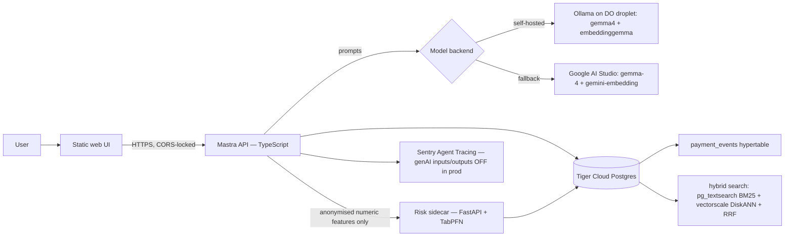

# TallyBard

**Open-source collections copilot for people who sell on credit.** Freelancers,
tutors, shops running a baki/udhaar book, tailors, caterers, small wholesalers,
community treasurers — anyone who delivers first and gets paid later.

TallyBard imports invoices *and* informal credit entries, predicts which open
receivables will be paid more than 7 days late, ranks a chase queue by
`amount × risk`, and drafts polite WhatsApp nudges in the client's language
(Bangla, English, or mixed) at friendly → firm → final tones. **A human
approves every message — nothing is ever sent automatically.**

> **Demo data is synthetic.** All clients, receivables, and notes in the demo
> dataset are generated (`db/generate_synthetic.py`) and labelled synthetic in
> the UI and docs.

Built with **PriorLabs-TabPFN**.

## Architecture



Deploy: `render.yaml` blueprint — static site + Node API + Python sidecar.

## Quickstart

```sh
# 1. database (Tiger Cloud Postgres 17+)
uv run scripts/db.py -f db/schema.sql     # extensions, hypertable, RRF fns
uv run db/generate_synthetic.py           # writes db/data/ledger.csv
uv run scripts/db.py -f db/seeds.sql      # seeds synthetic demo ledger

# 2. risk sidecar (Python 3.12, tabpfn local weights)
cd apps/risk-sidecar && uv venv --python 3.12 .venv && uv pip install -r requirements.txt
.venv/Scripts/python -m uvicorn main:app --port 8000     # .venv/bin/python on unix

# 3. Mastra API
cd ../api && npm ci && npx mastra dev

# 4. web UI (zero build)
cd ../web && python -m http.server 5173   # → http://localhost:5173
```

Copy `.env.example` → `.env` and fill in the values (never commit `.env`).

## The core loop

1. **Import** — paste CSV or informal text; Gemma extracts rows; you confirm
   before anything is written.
2. **Score** — `POST /score` on the sidecar refits TabPFN on the labelled
   history and returns `P(paid >7d late)` per open receivable with a
   SQL-derived "why" (amount, days overdue, client's prior late rate — real
   stats, not model explanations).
3. **Queue** — open receivables ranked by `amount × p_late7`.
4. **Draft** — nudge in the client's language and chosen tone, grounded by
   hybrid BM25+vector search over that client's notes and your previous nudges
   so wording never repeats.
5. **Approve** — the API marks the draft approved and returns a `wa.me`
   click-to-send link. *You* press send. Then `mark_sent`, and `mark_paid`
   when money lands.
6. **Weekly run** — a Mastra workflow scores + drafts the top of the queue and
   *suspends* until you resume with `approved: true`.

## Partner tech

| Piece | Used for |
|---|---|
| Tiger Data (Postgres 18 + TimescaleDB) | ledger, `payment_events` hypertable, BM25 (`pg_textsearch`) + DiskANN (`pgvectorscale`) hybrid search fused with RRF |
| Prior Labs TabPFN (3.5 local + v2 comparison) | `P(paid >7d late)` on tiny ledgers — honest head-to-head vs a past-late-rate baseline |
| Gemma (gemma4 via Ollama; gemma-4-26b-a4b-it via AI Studio) | text import extraction, nudge drafting, ledger chat |
| EmbeddingGemma / gemini-embedding-001 @768d | vector leg of hybrid search, nudge dedup |
| Mastra | tools, agent, suspend/resume weekly-chase workflow, Postgres memory |
| Sentry Agent Tracing | `instrument.mjs` + `@mastra/otel-bridge`; genAI inputs/outputs **off** in prod |
| DigitalOcean | Ollama droplet (CPU demo droplet + optional 3h GPU benchmark droplet) |
| Render | blueprint deploy of all three services |
| GitHub Copilot | starter PR + issues #2/#3 assigned to the coding agent; `docs/copilot-cli-task.md` is the Entire-captured CLI task |
| Entire | session capture for the Copilot CLI task |
| DevRelay | challenge/MLH wiring for this submission |

## Results (real runs — see `docs/results.md`)

Synthetic benchmark, time-split, `tabpfn==9.2.0` local CPU, 2026-10-16:

| train N | baseline AUC | TabPFN-3.5 AUC | TabPFN v2 AUC |
|---:|---:|---:|---:|
| 50 | **0.655** | 0.533 | 0.515 |
| 100 | **0.653** | 0.619 | 0.625 |
| 300 | 0.670 | 0.672 | **0.681** |

The free baseline wins at N=50 and stays competitive — TallyBard shows both
numbers instead of pretending the fancy model is always right. TabPFN-3.5
weights are **non-commercial** (demo/benchmark only); v2 is the permissive
Prior Labs licence. `docs/results.md` has the full table, commands, and dates.

## Honest limitations

- Synthetic data only — nothing here is evidence about real clients.
- `/score` refits TabPFN on every call (~1 min cold on CPU, less warm).
- TabPFN-3.5 weights are non-commercial; production/self-host use needs v2
  weights (permissive) or your own model. Verify licence terms yourself.
- `gemma-4-31b-it` hit AI Studio free-tier rate limits during testing — the
  fallback default is `gemma-4-26b-a4b-it`.
- No auth/multi-tenancy, no auto-send, no payments — by design.
- Public-dataset backtest was skipped: no payments dataset with a clearly
  verified licence was found in a 20-minute search.

## Prior art

[PayMind](https://dev.to/fracabu) (by fracabu) — a previous open-source
AI-collections project — inspired the space. TallyBard shares no code with it;
it differs in being self-hostable, model-swappable, handling informal credit
(baki/udhaar), scoring with TabPFN against an explicit baseline, and
hybrid-search-grounded language-aware drafting.

## Repo layout

```
apps/web/          static SPA (zero build, vanilla ES modules)
apps/api/          Mastra API — tools, agent, weekly-chase workflow, Sentry
apps/risk-sidecar/ FastAPI + TabPFN scoring, point-in-time features, backtest
db/                schema.sql, seeds.sql, synthetic generator
scripts/           db.py helper, bootstrap-ollama.sh
docs/              PLAN, STATUS, results, backtest.json, copilot-cli-task.md
render.yaml        Render blueprint
```

## Post-deadline commits

(none yet — every commit before 2026-10-18 23:59 PDT)

## Licence

MIT — see `LICENSE`. Model weights keep their own licences (Gemma Terms of
Use; TabPFN per Prior Labs — see results.md).
